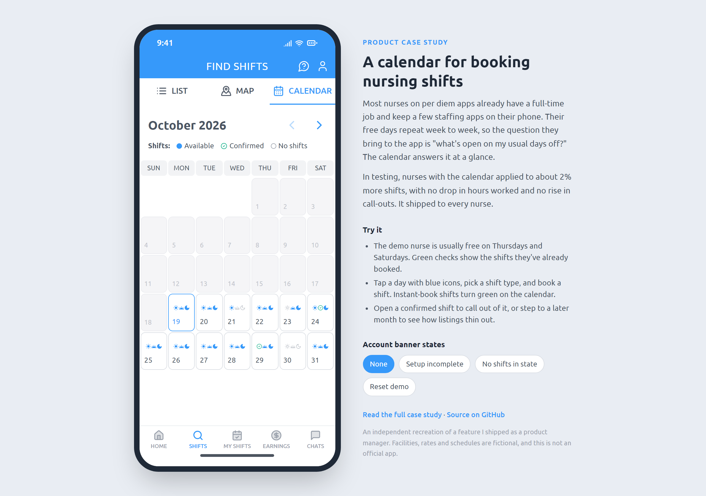
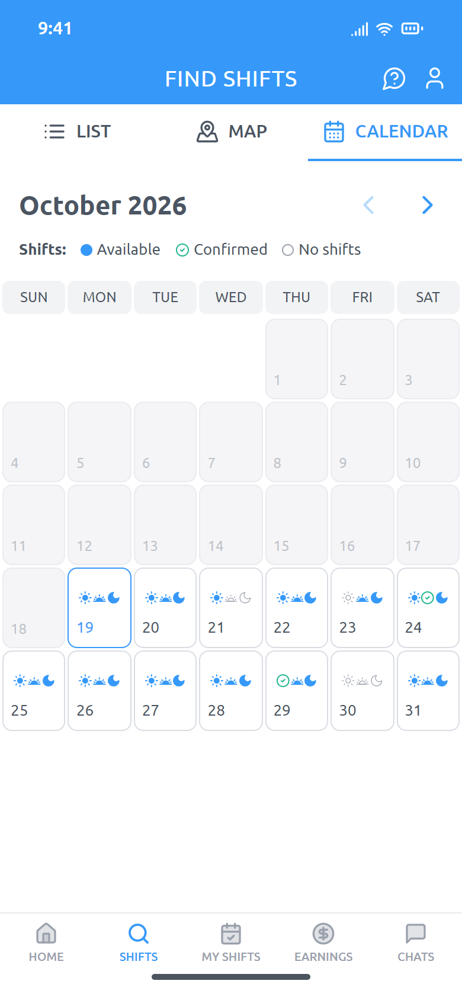
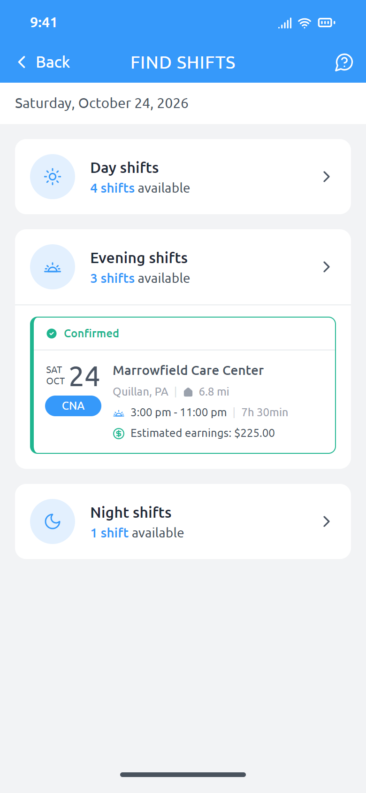
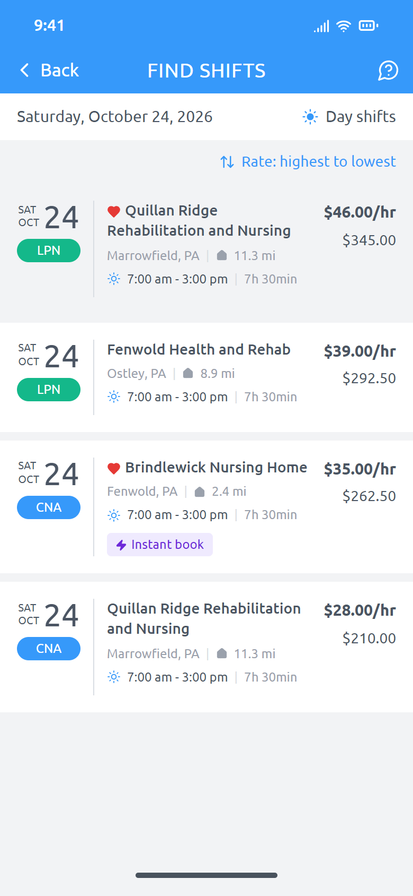
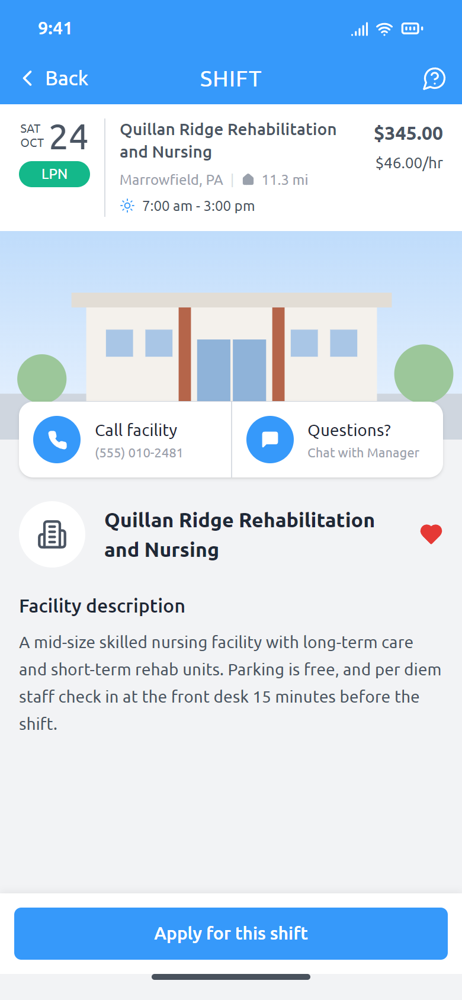

# Shift calendar: booking per diem nursing shifts by day

An interactive web recreation of a calendar view I shipped as the product manager on a nurse staffing app, plus the [case study](docs/CASE_STUDY.md) behind it.

**[Try the live prototype](https://josephfanpm.github.io/eshyft-calendar/)**



This is an independent portfolio project, not an official app. It follows the shipped Figma designs, but every facility, rate and schedule is fictional, and the company's branding and photography are left out.

## The short version

The nurses picking up per diem shifts are busy. Most have a full-time job, keep two or three other staffing apps on their phone, and tend to be free at the same times each week or month. They open the app already knowing their days off and want to know what's open on those days.

The app showed shifts in a list and on a map, and neither one lets you see a month at a glance. Nurses had to change date filters and remember their own bookings to find a shift that fit. The calendar shows, for every day, whether day, evening and night shifts are open and which ones you're already booked on.

I tested the calendar against the existing list and map. The primary metric was shift applications, with hours worked, confirmed shifts and call-outs as counter metrics to make sure extra applications weren't coming from nurses booking shifts they'd later drop. The calendar lifted applications without moving the counter metrics the wrong way, and it rolled out to every nurse. The [case study](docs/CASE_STUDY.md) covers the problem, the decisions and what I'd do next.

## What you can do in the prototype

| Calendar | Day view | Shifts by type | Shift detail |
|---|---|---|---|
|  |  |  |  |

- Browse the current month and the next four. Each day shows a day, evening and night icon: blue when shifts are open, a green check when you're confirmed, gray when nothing is available.
- Past days are disabled and show no icons. A confirmed shift in the past doesn't mean the nurse worked it, so the calendar only shows what's still ahead.
- Tap a day to see its shifts grouped by type, with your confirmed shifts shown in place. A day with nothing open shows the empty state.
- Open a shift, then apply or instant-book it. Instant-book shifts turn green on the calendar right away. Open a confirmed shift to call out of it.
- Reset the demo from the panel beside the phone to start over with the original bookings.

The demo nurse works a full-time job and is usually free on Thursdays and Saturdays, so that's where their booked shifts land.

## Running it locally

```bash
npm install
npm run dev     # http://localhost:5173
npm test        # calendar logic tests
npm run build
```

Built with React 19, TypeScript, Tailwind CSS v4 and Vite. The calendar rules (icon states, disabled past days, month grid) live in [`src/data.ts`](src/data.ts) with tests beside them, and the screens are in [`src/`](src).
