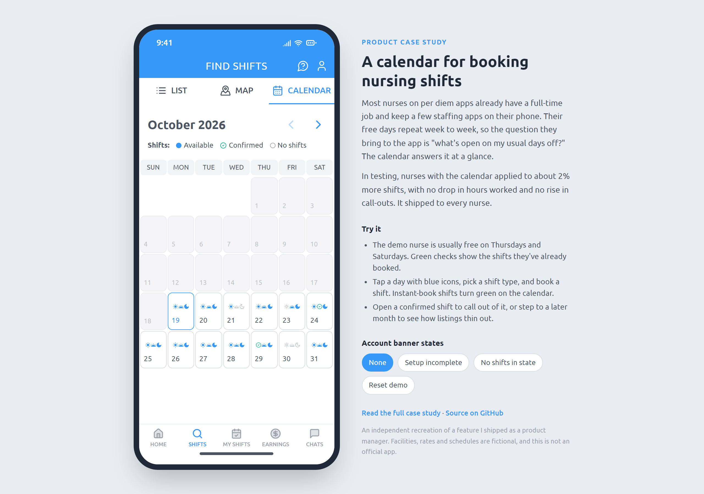
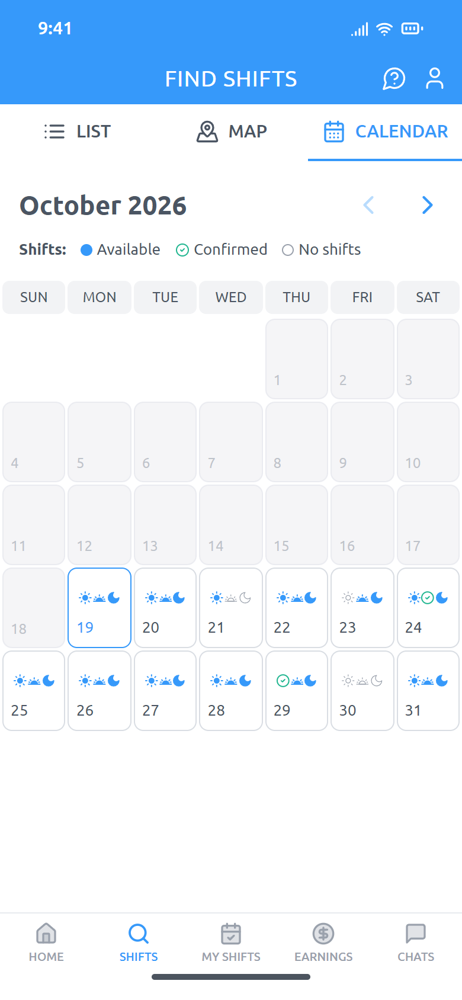
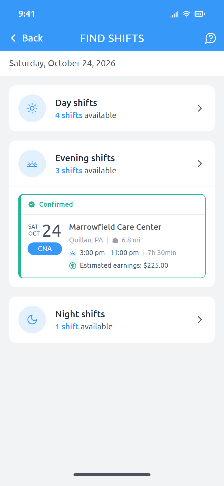
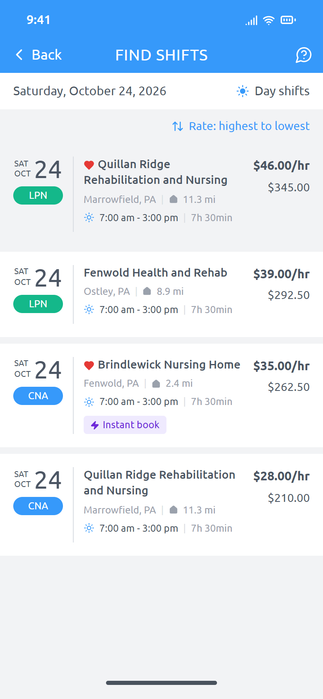
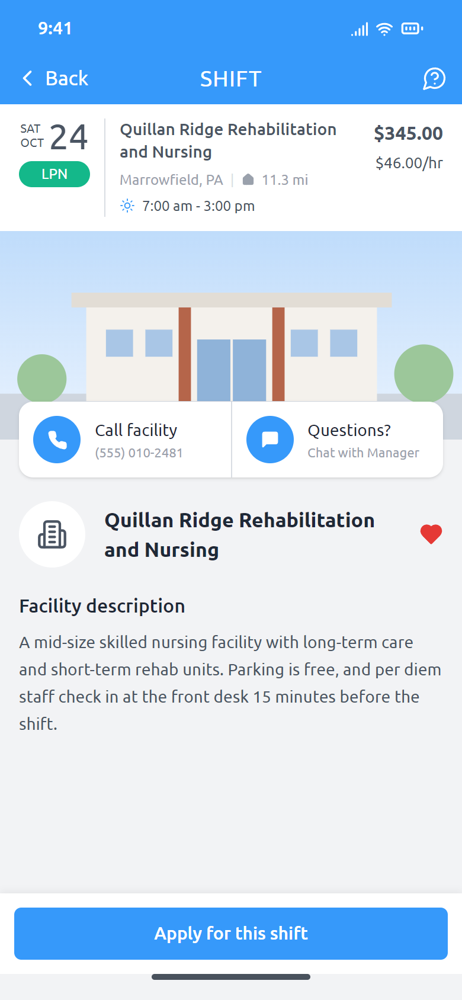

# Shift calendar: booking per diem nursing shifts by day

A calendar view that lets busy nurses see what's open on the days they're free. I shipped it as the product manager at ESHYFT, a nurse staffing marketplace. This repo is my interactive web recreation of it, plus the [case study](docs/CASE_STUDY.md).

**[Try the live prototype](https://josephfanpm.github.io/eshyft-calendar/)** · [Case study](docs/CASE_STUDY.md) · [Requirements](docs/PRD.md)



This is an independent portfolio project, not an official app. It follows the shipped Figma designs, but every facility, rate and schedule is fictional, and the company's branding and photography are left out.

## At a glance

| | |
|---|---|
| **Problem** | Nurses know their free days but couldn't see what was open on them without re-filtering a list or map for each date. |
| **User** | CNAs, LPNs and RNs with a full-time job who pick up per diem shifts around it. |
| **Solution** | A month calendar showing, per day, open and confirmed day, evening and night shifts. |
| **Result** | Beat the list and map on shift applications in a test, with counter metrics holding. Rolled out to every nurse. |
| **My role** | Product manager: problem, requirements, design partnership, test design, ship decision. |

## Problem

Nurses found shifts in a list and on a map. Both are organized around shifts, not days. To check what was open on their days off, a nurse had to change date filters, then compare the results against shifts they'd already confirmed. A nurse free every Thursday had to repeat that for each Thursday, because a list can't show a pattern across a month.

These nurses keep two or three other staffing apps on their phone and book whichever shift fits first. If our app couldn't answer "what's open on my usual days off?" quickly, another app would.

The signal came from our nurse feedback form: about 20% of nurses who gave feedback were unhappy with shift confirmation, and a missing calendar view was a common complaint.

## Target user

A nurse with a full-time job whose free time is predictable: every Thursday and Saturday, say, or the first weekend of the month. They open the app already knowing those days. The demo nurse in the prototype follows this pattern.

## Solution

| Calendar | Day view | Shifts by type | Shift detail |
|---|---|---|---|
|  |  |  |  |

- **Month view.** The current month and the next four. Each day shows a day, evening and night icon: blue when shifts are open, a green check when you're confirmed, gray when nothing is available.
- **Day view.** Tap a day to see its shifts grouped by type, with your confirmed shifts in place. A day with nothing open shows an empty state.
- **Book from the calendar.** Open a shift, then apply or instant-book it. Instant-book shifts turn green on the calendar right away. Open a confirmed shift to call out.
- **Past days disabled.** No icons on past days. A confirmed shift in the past doesn't mean the nurse worked it.

In the prototype, the panel beside the phone resets the demo to the original bookings.

## My role

- Defined the problem and goals from nurse feedback, and wrote the user stories.
- Worked with design on the Figma screens and finalized designs and copy.
- Scoped the release with engineering, who built it in the Flutter nurse app over three sprints.
- Designed the test: calendar vs. list and map, plus a pay-rate variant, with a primary metric and counter metrics set up front.
- Made the rollout call.
- Built this web recreation for my portfolio (React and TypeScript, with Claude Code as a pair programmer).

<!-- TODO(Joseph): Confirm the "My role" bullets match what you'd say in an interview, especially "scoped the release" and "made the rollout call". -->

## Key decisions and trade-offs

| Decision | Options | Chose | Gave up | Why |
|---|---|---|---|---|
| How nurses discover shifts | Keep list and map only, or add a calendar | Calendar alongside list and map | A single browsing surface | Nurses plan by day, and a calendar shows a month's pattern at a glance. It's also the format they know from other staffing apps. |
| Pay rate on the calendar | Plain calendar, or rate on each day | Plain calendar | Price comparison at a glance | Tested both. The plain calendar won. My hypothesis: rates turn an availability view into a price comparison, and nurses wait for the best-paying day. |
| Load time vs. release date | Hold until month loading was fast, or ship and fix in parallel | Ship, with a separate backend spike on load time | A faster first load at launch | Kept the release on track and handled load time as its own piece of work. |
| How to judge the test | Applications alone, or applications plus counter metrics | Applications as primary; hours worked, confirmed shifts and call-outs as counter metrics | A simpler readout | More applications only count if they become worked shifts. Counter metrics guard against impulse booking that later turns into call-outs. |
| What the calendar shows | All bookings incl. past, or only what's ahead; confirmed vs. open priority | Past days disabled; a confirmed shift outranks open ones in the same slot | A history view in the calendar | A past confirmed shift doesn't prove it was worked, and nurses need to see conflicts first. Encoded in [`dayState`](src/data.ts). |

The [case study](docs/CASE_STUDY.md) has the full reasoning.

## Success metrics

**Measured (from the shipped feature's test)**

| Metric | Type | Result |
|---|---|---|
| Shift applications per nurse | Primary | Higher with the calendar than with list and map |
| Hours worked, confirmed shifts, call-outs | Counter | Held; no movement in the wrong direction |
| Plain calendar vs. pay-rate variant | Variant | Plain calendar won |
| Rollout | Decision | Shipped to every nurse |

Effect sizes aren't published here.

<!-- TODO(Joseph): Optional. Add test design details you're comfortable sharing (test length, how nurses were split, sample size). You removed the lift figure on purpose in 99ac29b; only add a number back if you want it public. -->

**Proposed next KPIs (not yet measured)**

- Time from opening the app to submitting an application. The calendar should make booking faster, and an application count doesn't show that.
- Pay-rate-on-tap variant vs. plain calendar, on the same primary and counter metrics.

## Roadmap

Ordered by how directly each item serves the core job: "show me what's open on the days I'm free."

| | Item | Why |
|---|---|---|
| **Next** | Measure time to apply | Cheap. Fills the gap in the current metrics. |
| **Next** | Test pay rate after a nurse taps a day | Tests the pay-rate hypothesis without cluttering the month view. |
| **Later** | Save recurring availability ("free every Thursday") and notify when shifts open on those days | These schedules repeat. Nurses shouldn't check the same days by hand every week. |
| **Later** | Block out or import the full-time work schedule from the phone's calendar | The calendar can only show real availability if it knows about the rest of the week. |

<!-- TODO(Joseph): Add the status of the backend load-time spike (done, in progress, or dropped) if you want it on the roadmap. -->

## Technical overview

The prototype is a static single-page app with no backend. Shift data is generated in the browser.

| Area | Choice |
|---|---|
| Stack | React 19, TypeScript, Tailwind CSS v4, Vite, [lucide-react](https://lucide.dev) icons |
| Calendar rules | [`src/data.ts`](src/data.ts): month grid, per-slot icon state, disabled past days |
| Demo data | Seeded PRNG keyed by date, so the same day looks the same on every load. Shift density thins out in later months, like real postings. Confirmed shifts land on the demo nurse's usual free days. |
| Screens | [`CalendarTab.tsx`](src/CalendarTab.tsx), [`shifts.tsx`](src/shifts.tsx) (day, slot, list, map), [`ShiftDetail.tsx`](src/ShiftDetail.tsx), routing in [`App.tsx`](src/App.tsx) |
| Tests | [`src/data.test.ts`](src/data.test.ts) (Vitest): month grid, icon states, past-day rules, deterministic data |
| CI/CD | [`deploy.yml`](.github/workflows/deploy.yml) runs tests and a type-checked build, then deploys to GitHub Pages on every push to `main` |

The shipped feature was built by ESHYFT engineering in Flutter. This repo doesn't contain that code.

## Running it locally

```bash
npm install
npm run dev     # http://localhost:5173
npm test        # calendar logic tests
npm run build
```

## Credits

Product and prototype by Joseph Fan. Designs recreated from the shipped ESHYFT nurse app, with fictional data and no company branding.

<!-- TODO(Joseph): No LICENSE file. Add one if you want others to reuse the code, or note "All rights reserved." -->
